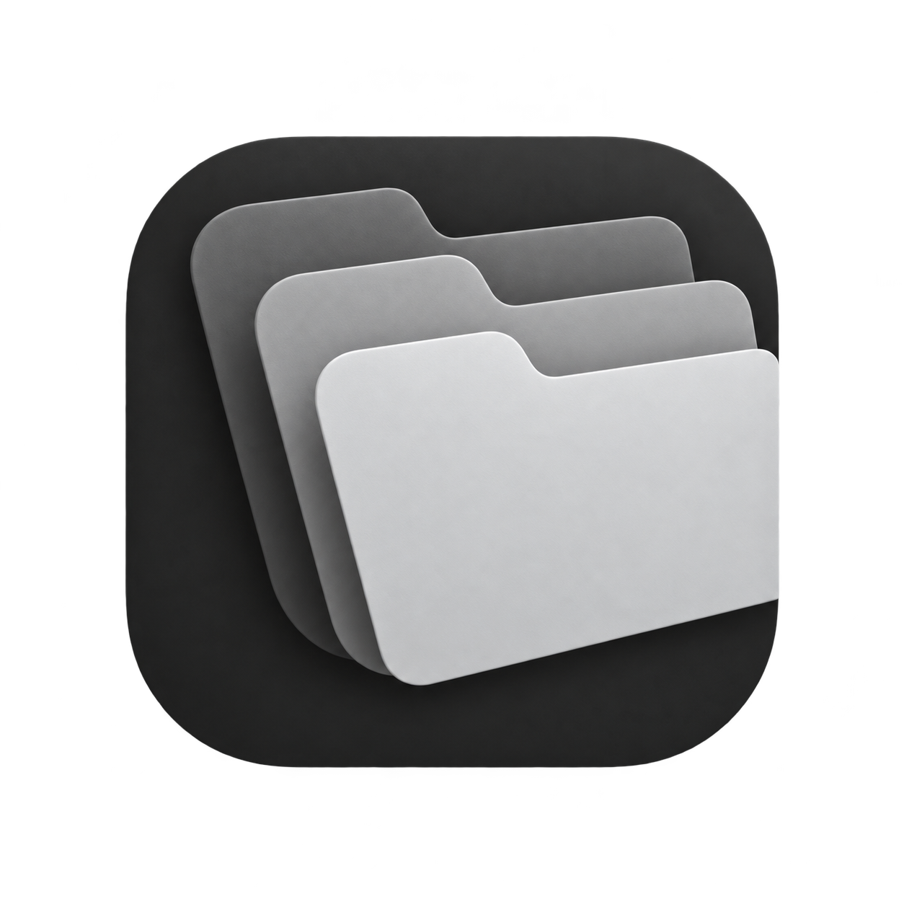

# Iconify



A compact, monochrome macOS app that turns your favorite images into custom Finder folder icons.

## Features

- Floating window with drag and drop from Finder.
- Customize one or multiple folders with a photo or illustration.
- Full-cover artwork across the folder, including its tab, or sticker mode.
- Drag to crop, pinch or use buttons to zoom.
- Restore default folder icons and export a PNG.
- Local image processing; no upload service is used by the app.

## Requirements

Apple silicon Mac, macOS 13 or later. Building requires Xcode Command Line Tools.

## Build and run

```sh
sh build.sh
open build/Iconify.app
```

The build script creates a locally signed app. It is not Apple-notarized.

## Use

1. Drop folders from Finder onto the window, or select Browse.
2. Drop an image or select Import image.
3. Drag the preview to crop and pinch or use the zoom buttons to resize.
4. Click Set folder icon.

Restore default removes the selected folders’ custom icons; it does not recover an earlier custom icon. Folder contents remain untouched.

## Validation

Compilation, icon decoding, rendering, drop processing, and apply/restore checks passed during development. End-to-end Finder interaction still requires manual verification.

## Creator

Created by **aadarsh ulayil** — [GitHub](https://github.com/aadarsh-ulayil).

The logo was prepared from the creator-supplied reference using an AI image-editing tool.
